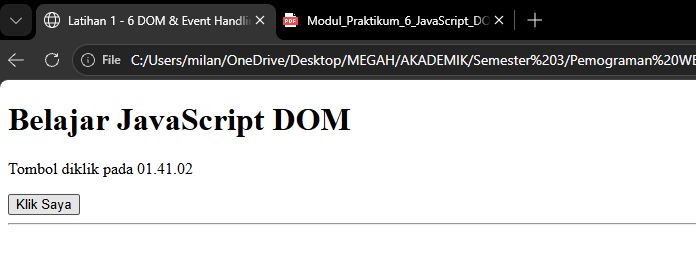
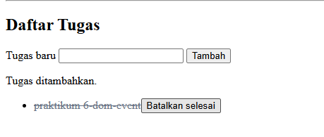
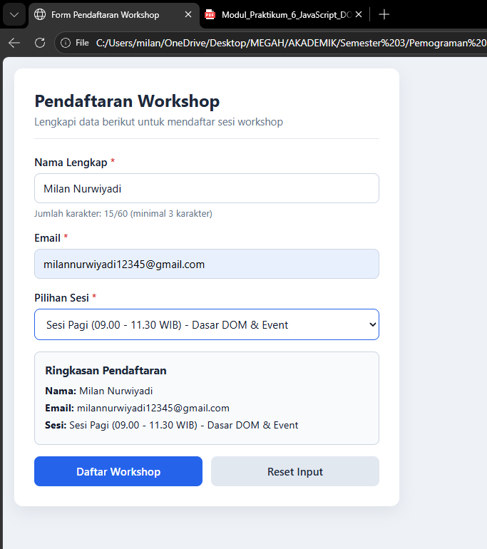
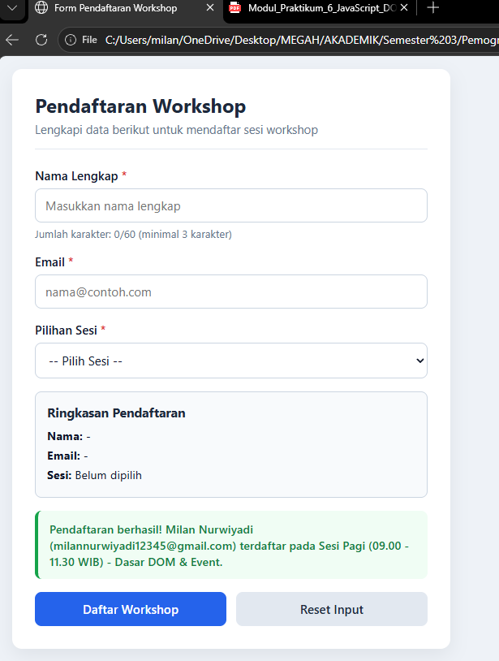

# Praktikum 6: JavaScript DOM dan Event Handling

Repository **`Lab6Web`** ini berisi hasil pengerjaan Praktikum 6 Mata Kuliah Pemrograman Web (Pertemuan 10), meliputi seluruh latihan manipulasi DOM, _event handling_, validasi form, To-Do List, serta **Mini Project: Form Pendaftaran Workshop**.

---

## 1. Tujuan Praktikum

1. Memahami Document Object Model (DOM) sebagai representasi dokumen HTML yang dapat diakses melalui JavaScript.
2. Menggunakan `id`, `class`, dan selector CSS untuk memilih elemen HTML (`getElementById`, `querySelector`, `querySelectorAll`).
3. Mengubah teks, atribut, kelas CSS, dan gaya elemen melalui JavaScript (`textContent`, `setAttribute`, `classList`).
4. Menangani event pengguna menggunakan `addEventListener()`.
5. Membuat validasi form dan menampilkan pesan sesuai kondisi input.
6. Mengembangkan halaman interaktif dengan minimal tiga fungsi yang berjalan benar.

---

## 2. Struktur File

Berikut adalah struktur direktori dan file pada repository `Lab6Web`:

```
lab6_dom_event/
├──latihan/
│   ├── index.html
│   ├── style.css
│   ├── script.js
|   ├── image/
│   ├── latihan1-mengubah teks DOM.png
│   ├── latihan2-event-click.png
│   ├── latihan3-gaya kelas css.png
│   ├── latihan4-event input.png
│   ├── latihan5-validasi form.png
│   ├── latihan6-to-do-list.png
├──miniroject/
│   ├── index.html
│   ├── style.css
│   └── script.js
└── README.md
```

## 3. Cara Menjalankan

1. **Clone atau Unduh Repository**
   ```bash
   git clone https://github.com/MilanNurwiyadi/-Lab6Web.git
   ```
2. **Buka di Editor Kode**
   Buka folder `Lab6Web` menggunakan Visual Studio Code.
3. **Jalankan di Browser**
   - Masuk ke folder `lab6_dom_event`, lalu buka folder `latihan` lalu buka file `index.html` menggunakan browser (Chrome, Edge, atau Firefox), atau klik kanan dan pilih **Open with Live Server**.
   - Buka **Developer Tools / Console** (`F12` atau `Ctrl + Shift + I`) untuk memastikan script berjalan dengan atribut `defer` tanpa error.

---

## 4. Langkah Kerja

### A. Tahap Persiapan & Latihan Praktikum

1. Membuat struktur folder kerja dan memisahkan kode ke dalam tiga file (`index.html`, `style.css`, `script.js`) dengan menghubungkan JavaScript menggunakan atribut `defer`.
2. **(Mengubah Teks dengan DOM):** Memilih elemen berdasarkan `id` dan memperbarui isi teks menggunakan properti `textContent`.  
   
3. **(Event `click`):** Menambahkan `addEventListener("click", ...)` pada tombol untuk memperbarui teks beserta stempel waktu (`new Date().toLocaleTimeString()`).  
   
4. **(Mengubah Kelas & Gaya CSS):** Menggunakan `classList.toggle()` untuk mengaktifkan dan menonaktifkan kelas `.highlight` serta `.teks-besar`.  
   
5. **(Event `input` & Penghitung Karakter):** Menghitung panjang teks (`value.length`) secara _real-time_ saat pengguna mengetik pada kolom input.  
   
6. **(Validasi Form Pendaftaran):** Menggunakan `event.preventDefault()` pada event `submit` untuk memeriksa input kosong, format email dengan _Regular Expression_, dan rentang usia `17–100`.  
   
7. **(To-Do List Sederhana):** Membuat elemen `<li>` secara dinamis dengan `document.createElement()`, menandai tugas selesai menggunakan `classList.toggle("selesai")`, serta menampilkan teks pengguna secara aman dengan `textContent`.  
   

---

## 5. Jawaban Pertanyaan Evaluasi

1. **Pengertian dan Manfaat DOM:** Document Object Model (DOM) adalah representasi struktur dokumen HTML dalam bentuk objek yang dapat diakses oleh JavaScript. Manfaatnya adalah memungkinkan pengembang memilih elemen, mengubah teks/atribut, mengatur kelas CSS, dan merespons interaksi pengguna secara dinamis tanpa memuat ulang halaman.
2. **Perbedaan `getElementById()`, `querySelector()`, dan `querySelectorAll()`:**
   - `getElementById()` memilih satu elemen spesifik berdasarkan nilai atribut `id`.
   - `querySelector()` memilih **elemen pertama** yang cocok dengan selector CSS yang diberikan.
   - `querySelectorAll()` memilih **semua elemen** yang cocok dengan selector CSS yang diberikan.
3. **Fungsi `addEventListener()` dan Contoh Event:** Berfungsi menghubungkan sebuah event pada elemen HTML dengan fungsi (_callback_) yang dijalankan saat event terjadi. Tiga contoh event: `click`, `input`, dan `change`.
4. **Fungsi `event.preventDefault()` pada `submit`:** Mencegah perilaku bawaan browser yang memuat ulang (_reload_) atau mengirim form secara langsung sebelum proses validasi JavaScript selesai dijalankan.
5. **Perbedaan `textContent` dan `innerHTML`:** `textContent` memperlakukan konten sebagai teks biasa sehingga aman untuk menampilkan input pengguna, sedangkan `innerHTML` memparsing konten sebagai markup HTML sehingga berisiko menimbulkan celah keamanan (XSS) jika diisi input pengguna yang tidak tervalidasi.
6. **Cara Kerja `classList.toggle()`:** Menambahkan nama kelas CSS ke elemen jika kelas tersebut belum ada, dan menghapusnya jika kelas tersebut sudah ada, sehingga perubahan tampilan elemen dapat dikendalikan secara bergantian melalui aturan CSS.
7. **Tiga Skenario Pengujian Validasi Form:**
   - Mengirimkan form saat semua kolom dalam keadaan kosong (harus muncul pesan error wajib diisi).
   - Mengisi email dengan format yang tidak sesuai seperti tanpa tanda `@` (harus muncul pesan format email tidak valid).
   - Mengisi seluruh kolom sesuai aturan yang ditentukan (harus muncul pesan sukses dan form diproses).

---

# Mini Project: Form Pendaftaran Workshop

Repository ini berisi hasil pengerjaan **Mini Project Praktikum 6** Mata Kuliah Pemrograman Web (Pertemuan 10), yaitu aplikasi web interaktif **Form Pendaftaran Workshop** menggunakan HTML, CSS, dan JavaScript DOM & Event Handling.

---

## 1. Tujuan Pembuatan

1. Menerapkan pemilihan dan manipulasi elemen DOM menggunakan `getElementById()`, `textContent`, dan `classList`.
2. Menangani interaksi pengguna secara dinamis dengan `addEventListener()` untuk event `input`, `change`, `submit`, dan `click`.
3. Membangun validasi form sisi klien (_client-side validation_) dengan pesan kesalahan dan konfirmasi sukses langsung di halaman.
4. Menyediakan fitur interaktif pendukung seperti penghitung karakter, ringkasan input langsung (_live preview_), dan tombol reset input.

---

## 2. Struktur File

Berikut adalah struktur direktori dan file pada repository `Lab6Web`:

```
lab6_dom_event/
├──latihan/
│   ├── index.html
│   ├── style.css
│   ├── script.js
|   ├── image/
│   ├── latihan1-mengubah teks DOM.png
│   ├── latihan2-event-click.png
│   ├── latihan3-gaya kelas css.png
│   ├── latihan4-event input.png
│   ├── latihan5-validasi form.png
│   ├── latihan6-to-do-list.png
├──miniroject/
│   ├── index.html
│   ├── style.css
│   └── script.js
└── README.md
```

## 3. Cara Menjalankan

1. **Clone atau Unduh Repository**
   ```bash
   git clone https://github.com/MilanNurwiyadi/-Lab6Web.git
   ```
2. **Buka di Editor Kode**
   Buka folder `Lab6Web` menggunakan Visual Studio Code.
3. **Jalankan di Browser**
   - Masuk ke folder `lab6_dom_event`, lalu buka folder `miniproject` lalu buka file `index.html` menggunakan browser (Chrome, Edge, atau Firefox), atau klik kanan dan pilih **Open with Live Server**.
   - Buka **Developer Tools / Console** (`F12` atau `Ctrl + Shift + I`) untuk memastikan script berjalan dengan atribut `defer` tanpa error.

---

## 4. Langkah-Langkah Pembuatan Mini Project

### Langkah 1: Membuat Struktur HTML (`index.html`)

- Membuat kerangka dasar HTML5 dan menghubungkan `style.css` serta `script.js` menggunakan atribut `defer` di bagian `<head>` agar skrip dieksekusi setelah seluruh elemen DOM selesai dimuat.
- Menyusun elemen `<form id="formPendaftaranWorkshop" novalidate>` yang berisi:
  - Input **Nama Lengkap** (`#nama`) dengan batas maksimal 60 karakter (`maxlength="60"`) dan indikator penghitung karakter (`#hitungKarakter`).
  - Input **Email** (`#email`).
  - Dropdown **Pilihan Sesi Workshop** (`#sesi`) dengan tiga opsi sesi.
  - Kotak **Ringkasan Pendaftaran** (`#ringkasanNama`, `#ringkasanEmail`, `#ringkasanSesi`) untuk menampilkan pratinjau data secara langsung.
  - Area **Pesan Notifikasi** (`#pesanNotifikasi`) dengan atribut `aria-live="polite"`.
  - Tombol **Daftar Workshop** (`type="submit"`) dan **Reset Input** (`#tombolReset`).

### Langkah 2: Merancang Tampilan Responsif & Status Visual (`style.css`)

- Mengatur tata letak kartu form di tengah layar menggunakan Flexbox dengan lebar maksimal `540px` serta menambahkan _media query_ (`@media (max-width: 480px)`) agar tombol tersusun rapi secara vertikal pada layar perangkat mobile.
- Membuat kelas CSS `.notifikasi-error` (latar merah muda dengan aksen merah) dan `.notifikasi-sukses` (latar hijau muda dengan aksen hijau) yang diatur kemunculannya melalui JavaScript.

### Langkah 3: Pemilihan Elemen DOM (`script.js`)

- Mengambil referensi seluruh elemen yang dibutuhkan dari HTML menggunakan `document.getElementById()` dan menyimpannya ke dalam variabel konstanta (`const`).

### Langkah 4: Membuat Fitur Penghitung Karakter & Ringkasan Langsung (`input` & `change`)

- Menghubungkan event `input` pada kolom `#nama` untuk menghitung panjang teks secara real-time (`inputNama.value.length`) dan memperbarui `#ringkasanNama`.
- Menghubungkan event `input` pada kolom `#email` untuk memperbarui `#ringkasanEmail` saat pengguna mengetik.
- Menghubungkan event `change` pada dropdown `#sesi` untuk mendeteksi perubahan pilihan dan langsung menampilkan sesi yang dipilih pada `#ringkasanSesi`.

### Langkah 5: Menerapkan Validasi Form (`submit`)

- Menambahkan `addEventListener("submit", ...)` pada form dan memanggil `event.preventDefault()` agar halaman tidak dimuat ulang sebelum pemeriksaan selesai.
- Melakukan pengecekan kondisi secara berurutan:
  1. **Nama kosong:** Menampilkan pesan error jika nama belum diisi.
  2. **Panjang nama minimal:** Memastikan nama terdiri dari minimal **3 karakter** (`nama.length < 3`).
  3. **Format email:** Memeriksa kecocokan format email menggunakan pola Regular Expression (`/^[^\s@]+@[^\s@]+\.[^\s@]+$/`).
  4. **Pilihan sesi:** Memastikan pengguna telah memilih salah satu sesi workshop.
- Jika semua input valid, aplikasi menampilkan pesan sukses beserta ringkasan data pendaftar menggunakan `textContent` (aman dari injeksi HTML), lalu mereset form.

### Langkah 6: Menambahkan Fungsi Reset Input (`click`)

- Menghubungkan event `click` pada `#tombolReset` untuk mengosongkan seluruh input form (`formWorkshop.reset()`), mengembalikan penghitung karakter ke `0`, mereset kotak ringkasan, dan menyembunyikan pesan notifikasi.

---

## 5. Skenario Pengujian & Screenshot Hasil

1. **Tampilan Awal & Live Preview Input**
   - Mengisi nama, email, dan memilih sesi pada dropdown; penghitung karakter dan kotak ringkasan terisi secara langsung.  
     

2. **Pengujian Validasi Gagal (Error)**
   - Mengirimkan nama kurang dari 3 karakter, format email salah, atau sesi belum dipilih; tampil pesan peringatan berwarna merah.  
     

3. **Pengujian Validasi Berhasil (Sukses) & Reset**
   - Mengirimkan form dengan seluruh data valid; tampil pesan konfirmasi berwarna hijau dan input kembali bersih.  
     
